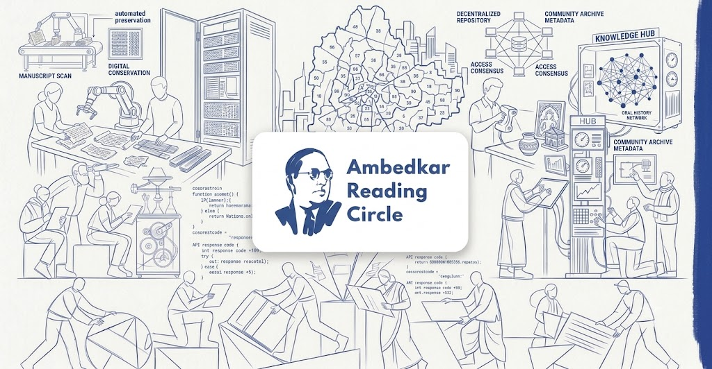

  <picture>
    
  </picture>

While Ambedkar Reading Circle occupies parks and public spaces with books, conversations, and Babasaheb's iconographies, this GitHub presence occupies the open-source engineering commons, building open tools and resources that make anti-caste knowledge more accessible, visible, and reusable.

## Current Projects

| Project | Description | Website | Repository |
| --- | --- | --- | --- |
| 🌐 **ARC Bengaluru** | Official website for the Bengaluru chapter | Coming Soon | [repo](https://github.com/ambedkar-reading-circle/arc-bengaluru) |
| 🎭 **Dramas of Discrimination** | Interactive workshop toolkit based on Theatre of the Oppressed | Coming Soon | [repo](https://github.com/ambedkar-reading-circle/dramas-of-discrimination) |

## Contribute

We build in the open. These projects are still taking shape — and as they grow, we will be inviting contributions. Watch the repositories, open Issues to share ideas or flag gaps, and send Pull Requests when you are ready to build with us.

## Join Us

- 📸 **Instagram** — [@arc.bangalore](https://www.instagram.com/arc.bangalore/)
- 💬 **WhatsApp Community** — [Join the group](https://chat.whatsapp.com/DsZYQiVREdC1f7R0FmT1LJ)